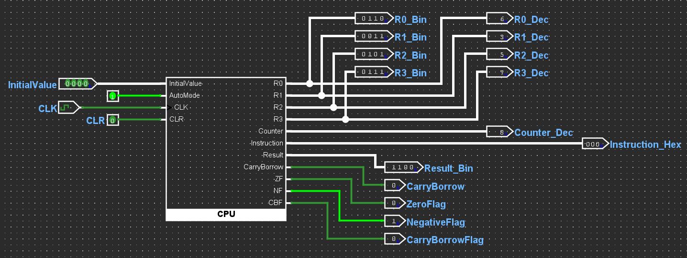

# 4-Bit CPU with a C++ Assembler

An educational 4-bit CPU designed in **Logisim Evolution**, with a custom 9-bit instruction set and a **C++ assembler** that translates assembly into machine code and loads it into the CPU's instruction ROM.

> **Academic project:** developed for the **Computer Architecture** course at **MET Institute**, under the supervision of **Dr. Abeer Heikal**.

This is a teaching-scale design simulated in software. It is not a physical processor and not intended for real workloads.

---

## Overview

The project has two parts that work together:

1. **The CPU** (`CPU.circ`): a single-cycle design built from basic components: half and full adders, an add/subtract unit, logic units, flag circuits, registers, a register bank, a synchronous counter, a ROM and a gate-level instruction decoder.
2. **The assembler** (`main.cpp`): reads `program.asm`, encodes each line into a 9-bit instruction, writes `program.hex`, and updates the ROM contents stored in `CPU.circ`.

The workflow is:

```
program.asm  ->  C++ assembler  ->  program.hex + ROM contents in CPU.circ  ->  run in Logisim Evolution
```

## Features

- 4-bit data path with four general-purpose registers (R0-R3)
- 9-bit instructions, 16-word instruction ROM (4-bit address)
- Six instructions: `ADD`, `SUB`, `AND`, `OR`, `XOR`, `LOAD`
- Arithmetic/logic unit built from the project's own adder and logic subcircuits
- Zero, Negative and Carry/Borrow flag outputs
- 4-bit synchronous counter used as the program counter
- Gate-level instruction decoder
- C++ assembler with basic error reporting
- `Environment` circuit for running programs and observing registers, counter, instruction and flags

## CPU Architecture

### Main components

| Component | Circuit | Description |
| --------- | ------- | ----------- |
| Half Adder / Full Adder | `HalfAdder`, `FullAdder` | Full adder is built from two half adders and an OR gate |
| Add/Sub | `AddSub` | 4 full adders plus XOR gates; the control input selects add or subtract |
| Logic units | `AndUnit`, `OrUnit`, `XorUnit` | Bitwise operations on two 4-bit inputs |
| ALU | `ALU` | Combines AddSub and the logic units; a 4-to-1 multiplexer driven by `S1`/`S0` selects the result |
| Flags | `ZeroFlag`, `NegativeFlag`, `CarryBorrowFlag` | Derived from the ALU result and carry/borrow output |
| Registers | `Register1Bit`, `Register4Bit` | D flip-flop based registers with load control and clear |
| Register bank | `RegisterBank` | Four 4-bit registers, one write port, two read ports (A and B) |
| Program counter | `SyncCounter4Bit` | 4-bit synchronous counter (T flip-flops and AND gates) |
| Instruction memory | `InstructionMemory` | 16 x 9-bit ROM |
| Decoder | `InstructionDecoder` | Splits the instruction into fields and generates control signals |
| Top level | `CPU` | Connects all components |
| Test bench | `Environment` | Clock, reset and input pins with register, counter, instruction and flag outputs |

### Specifications

| Item | Value |
| ---- | ----- |
| Data width | 4 bits |
| Instruction width | 9 bits |
| Registers | 4 (R0-R3) |
| Instruction ROM | 16 words (4-bit address) |
| Program counter | 4-bit synchronous counter |
| Instructions | ADD, SUB, AND, OR, XOR, LOAD |
| Flags | ZF, NF, CBF |

### CPU interface (`CPU` circuit)

| Signal | Direction | Width | Description |
| ------ | --------- | ----- | ----------- |
| `CLK` | Input | 1 | Clock |
| `CLR` | Input | 1 | Clears the registers and the counter |
| `InitialValue` | Input | 4 | Value written to the destination register when `AutoMode` is 0 |
| `AutoMode` | Input | 1 | 1 = normal program execution; 0 = write `InitialValue` instead of the instruction data |
| `R0`-`R3` | Output | 4 each | Register contents |
| `Counter` | Output | 4 | Current program counter value |
| `Instruction` | Output | 9 | Current instruction (hexadecimal) |
| `Result` | Output | 4 | ALU result |
| `CarryBorrow` | Output | 1 | Carry/borrow of the current ADD/SUB |
| `ZF`, `NF`, `CBF` | Output | 1 each | Zero, Negative, Carry/Borrow flags |

The flags are combinational outputs of the ALU for the current instruction; they are not stored, and no instruction uses them for branching.

## Instruction Set

### Instruction formats

**ALU instructions** (`ADD`, `SUB`, `AND`, `OR`, `XOR`)

| Field | OpCode | SrcA | SrcB | Dest |
| ----- | ------ | ---- | ---- | ---- |
| Bits | 8-6 | 5-4 | 3-2 | 1-0 |

**LOAD**

| Field | OpCode | Dest | Immediate |
| ----- | ------ | ---- | --------- |
| Bits | 8-6 | 5-4 | 3-0 |

### OpCodes

| Instruction | OpCode | Operation |
| ----------- | ------ | --------- |
| `ADD Ra, Rb, Rd` | `000` | Rd = Ra + Rb |
| `SUB Ra, Rb, Rd` | `001` | Rd = Ra - Rb |
| `AND Ra, Rb, Rd` | `010` | Rd = Ra AND Rb |
| `OR Ra, Rb, Rd` | `011` | Rd = Ra OR Rb |
| `XOR Ra, Rb, Rd` | `100` | Rd = Ra XOR Rb |
| `LOAD Rd, imm` | `101` | Rd = imm (0-15) |

OpCodes `110` and `111` are unassigned. All arithmetic is 4-bit, so results wrap modulo 16.

### Registers

| Register | Address |
| -------- | ------- |
| R0 | `00` |
| R1 | `01` |
| R2 | `10` |
| R3 | `11` |

## How an Instruction Executes

Each clock pulse executes one instruction:

1. **Fetch:** the counter output addresses the ROM, which returns a 9-bit instruction.
2. **Decode:** the decoder splits the instruction into `SrcA`, `SrcB`, `Dest`, the immediate `Value`, and the control signals `S1`, `S0`, `Controller` (add vs. subtract), `LOAD_EN` and `WE`/`PC_EN`. Because `Dest` sits in different bits for ALU instructions (1-0) and LOAD (5-4), a multiplexer controlled by `LOAD_EN` selects the right field.
3. **Read and execute:** the register bank outputs the registers addressed by `SrcA` and `SrcB`; the ALU computes the selected operation.
4. **Write back:** a multiplexer chooses between the ALU result and the LOAD immediate, and the value is written to `Dest`.
5. **Advance:** on the same clock edge, the counter increments to the next address.

There is no jump or branch instruction, so execution always proceeds sequentially.

## The C++ Assembler

`main.cpp` is a small command-line assembler with no external dependencies. When run it:

1. reads `program.asm` from the **current working directory**, line by line;
2. splits each line into a mnemonic and up to three operands (trailing commas are removed);
3. encodes the instruction with shifts and ORs according to the formats above;
4. writes the hex words to `program.hex` in Logisim's `v2.0 raw` image format;
5. opens `../CPU.circ` (one directory above the working directory) and replaces the ROM `contents` block with the new program.

### Assembly syntax

```asm
LOAD R0, 6          ; LOAD Rd, immediate (0-15)
ADD  R0, R1, R2     ; OP Ra, Rb, Rd
```

- Mnemonics and register names must be **uppercase** (`LOAD`, `ADD`, `R0`...).
- Immediates are decimal values from 0 to 15.
- ALU instructions take three registers: first source, second source, destination.
- Blank lines are skipped.
- Labels, directives and comment-only lines are **not** supported. (Text after the last operand is ignored by the parser, so trailing comments happen to work, but they are not a designed feature.)
- A program may contain at most 16 instructions (the ROM size).

### Errors reported

| Condition | Message |
| --------- | ------- |
| Unknown mnemonic | `Invalid instruction: ...` |
| Bad register name | `Invalid register ...` |
| LOAD immediate outside 0-15 or not a number | `Invalid LOAD value: ...` |
| More than 16 instructions | `Error: Program exceeds ROM capacity!` |
| Missing input or output file | Message naming the file that could not be opened |

### Build and run

Compile with any C++ compiler, for example:

```bash
g++ -std=c++17 -o assembler main.cpp
```

Run it from a directory that contains `program.asm` and sits one level below `CPU.circ` (see [Project Structure](#project-structure)):

```bash
cd assembler
./assembler
```

## Example Program

`program.asm`:

```asm
LOAD R0, 6
LOAD R1, 3
ADD R0, R1, R2
ADD R1, R2, R3
SUB R0, R1, R3
AND R0, R1, R2
OR R0, R1, R3
XOR R0, R1, R2
```

Assembler output:

```
Hex Code: 146
Hex Code: 153
Hex Code: 006
Hex Code: 01B
Hex Code: 047
Hex Code: 086
Hex Code: 0C7
Hex Code: 106

CPU file loaded successfully!
ROM contents section found!

CPU project updated successfully!
```

`program.hex`:

```
v2.0 raw
146
153
006
01B
047
086
0C7
106
```

### Encoding

| Addr | Instruction | Binary (`op dest/srcA srcB dest`) | Hex |
| ---: | ----------- | --------------------------------- | --- |
| 0 | `LOAD R0, 6` | `101 00 0110` | `146` |
| 1 | `LOAD R1, 3` | `101 01 0011` | `153` |
| 2 | `ADD R0, R1, R2` | `000 00 01 10` | `006` |
| 3 | `ADD R1, R2, R3` | `000 01 10 11` | `01B` |
| 4 | `SUB R0, R1, R3` | `001 00 01 11` | `047` |
| 5 | `AND R0, R1, R2` | `010 00 01 10` | `086` |
| 6 | `OR R0, R1, R3` | `011 00 01 11` | `0C7` |
| 7 | `XOR R0, R1, R2` | `100 00 01 10` | `106` |

### Expected register values after each clock pulse

| Pulse | R0 | R1 | R2 | R3 |
| ----: | -- | -- | -- | -- |
| Initial | `0000` | `0000` | `0000` | `0000` |
| 1 | `0110` | `0000` | `0000` | `0000` |
| 2 | `0110` | `0011` | `0000` | `0000` |
| 3 | `0110` | `0011` | `1001` | `0000` |
| 4 | `0110` | `0011` | `1001` | `1100` |
| 5 | `0110` | `0011` | `1001` | `0011` |
| 6 | `0110` | `0011` | `0010` | `0011` |
| 7 | `0110` | `0011` | `0010` | `0111` |
| 8 | `0110` | `0011` | `0101` | `0111` |

`TestProgram.md` also contains the shorter 7-instruction test (without `ADD R1, R2, R3`) that matches the course specification in `Instructions.md`.



## Running the CPU in Logisim Evolution

The circuit file was saved with **Logisim Evolution v5.0.0**.

1. Install [Logisim Evolution](https://github.com/logisim-evolution/logisim-evolution).
2. Open `CPU.circ`.
3. In the circuit explorer, open the **`Environment`** circuit.
4. Set `AutoMode` to 1, pulse `CLR` high and then low to reset.
5. Advance the clock one pulse at a time (toggle the `CLK` clock manually or use *Simulate > Tick Once*), or enable automatic ticking.
6. Watch `R0`-`R3`, `Counter`, `Instruction` and the flag outputs update after each pulse.

To run a different program: edit `program.asm`, run the assembler, then reopen (or reload) `CPU.circ` in Logisim. Alternatively, load `program.hex` into the ROM in the `InstructionMemory` circuit via the ROM's *Load Image* menu.

### Behavior to be aware of

- There is **no halt instruction**. The counter keeps counting through all 16 ROM addresses and wraps. Unused ROM words are zero, which decodes as `ADD R0, R0, R0`, so stop the clock after your last instruction.
- The ROM holds at most 16 instructions.

## Project Structure

```
.
├── README.md            # Project documentation
├── LICENSE              # MIT License
├── CPU.circ             # Logisim Evolution project (all circuits, ROM contents)
├── Instructions.md      # Course specification of the components and instruction set
├── TestProgram.md       # Test programs and expected register values
└── assembler/
    ├── main.cpp         # C++ assembler
    ├── program.asm      # Assembly source
    └── program.hex      # Generated machine code (Logisim v2.0 raw format)
```

The assembler opens `program.asm` in its working directory and `../CPU.circ`, so it must be run from inside `assembler/`.

## Technologies

- **Logisim Evolution** v5.0.0: circuit design and simulation
- **C++**: standard library only (file I/O, string handling)
- **Markdown**: documentation

## Limitations

- No jump/branch instructions, no data memory, no stack
- 16-instruction maximum program size
- Flags are outputs only and are not used by any instruction
- Assembler supports only the six instructions above, with no labels or comment-only lines
- Simulated in Logisim only; not synthesized or built in hardware

## Academic Context

This project was developed as part of the **Computer Architecture** course at **MET Institute**, under the supervision of **Dr. Abeer Heikal**. The course specification (`Instructions.md`) defines the components, instruction formats and test program; the circuit implementation and the C++ assembler are my own work for the course.

## Learning Outcomes

- Building a processor bottom-up from gates, adders, flip-flops and multiplexers
- Designing an instruction format and mapping it to decoder control signals
- Understanding how a program counter, ROM, register bank and ALU cooperate in a single-cycle design
- Writing an assembler that turns text into machine code and integrates it with a hardware simulation
- Testing a design against expected register values after every clock pulse

## License

This project is released under the [MIT License](LICENSE).

## Acknowledgments

Thanks to Dr. Abeer Heikel and MET Institute for the Computer Architecture course and project specification, and to the Logisim Evolution developers for the simulator.
